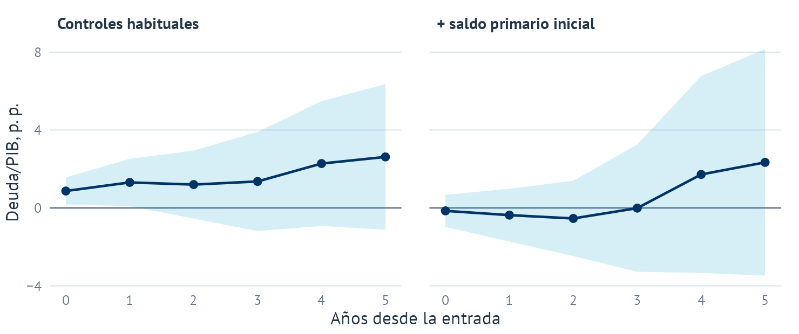

```{=html}
<div class="feature">
<picture>
<source media="(max-width: 600px)" srcset="../images/research/consolidation-irf-es-narrow.png">

</picture>
<p class="feature-caption">Ratio deuda/PIB tras entrar en consolidación fiscal, UE-27, 1996–2024. El primer gráfico usa los controles habituales; el segundo compara con países que parten de un saldo primario parecido. Los puntos son estimaciones y las bandas, intervalos de confianza del 95 %.</p>
</div>
```

