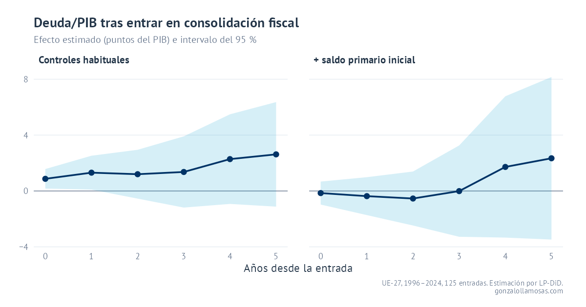

{.post-banner fig-alt="Respuesta del ratio deuda/PIB a la entrada en consolidación fiscal con intervalos del 95 %. Izquierda: controles habituales, la subida es significativa en el año de entrada y el siguiente. Derecha: añadiendo el saldo primario inicial, las estimaciones se sitúan en torno a cero."}

*Actualizado el 21 de octubre de 2026. La primera versión de esta entrada resumía un borrador anterior del trabajo; la versión revisada, ahora en evaluación en una revista, no mantiene algunas de aquellas conclusiones y esta entrada se ha reescrito para reflejarla.*

La intuición es sencilla. Si un país recorta su déficit, su deuda debería
crecer menos y el ratio deuda/PIB debería bajar. Con Cristina Mazas
Pérez-Oleaga y José M. Domínguez-Martínez hemos contrastado esa intuición
con los datos de la UE-27 entre 1996 y 2024. No encontramos que entrar en
consolidación fiscal reduzca el ratio de deuda en ninguno de los horizontes
que medimos, hasta cinco años.

## Qué hicimos

Llamamos entrada en consolidación al año en que el saldo primario ajustado
por el ciclo mejora al menos un punto del PIB potencial. En la muestra de
estimación hay 125 entradas. Medimos su efecto con proyecciones locales en
diferencias en diferencias (Dube, Girardi, Jordà y Taylor, 2025), que
comparan cada entrada solo con países que no consolidan en la ventana que
se está midiendo.

Hay un problema de partida: los países que consolidan no se parecen a los
demás. Llegan con un saldo primario 2,6 puntos peor que los países con los
que se comparan, y la probabilidad de entrar en consolidación pasa del 8 %
con las cuentas equilibradas al 46 % con déficits por encima del 7 %. Por
eso damos cada resultado de dos maneras: con los controles habituales y
añadiendo el saldo primario del año anterior, es decir, comparando con
países que parten de una posición fiscal parecida.

## Qué encontramos

Frente a países con una posición fiscal de partida parecida, no detectamos
ninguna reducción del ratio de deuda. Las estimaciones son ligeramente
negativas los tres primeros años, con intervalos de uno o dos puntos del PIB
a cada lado, y a cuatro y cinco años los intervalos son tan anchos que dicen
poco en cualquier dirección.

Con los controles habituales, en cambio, el ratio sube alrededor de un punto
en el año de entrada y en el siguiente, y esa subida es estadísticamente
significativa. La diferencia entre las dos lecturas está en el punto de
partida: los países con peor saldo acumulan más deuda en los años
siguientes, consoliden o no.

El esfuerzo fiscal es real. El saldo primario mejora y su contribución
acumulada a la deuda llega a varios puntos del PIB. ¿Por qué no se nota en
el ratio? Descomponemos la variación de la deuda de forma exacta en tres
partes: el saldo primario, el efecto bola de nieve (intereses frente a
crecimiento) y los ajustes stock-flujo, que recogen lo que mueve la deuda
sin pasar por el déficit. La mejora del saldo primario queda compensada por
las otras dos partes, y un contraste conjunto rechaza en todos los
horizontes que la variación de la deuda sea igual a la contribución del
saldo primario por sí sola.

Esa compensación viene acompañada de tres cosas:

- El PIB real cae y sigue por debajo del de los países de comparación
  durante todo el horizonte.
- La inversión pública cae de forma persistente. Es la partida que la
  consolidación recorta con más regularidad.
- No detectamos una bajada de las primas de riesgo. Los intervalos no
  excluyen bajadas moderadas, y los mercados pueden reaccionar más al
  anuncio de un paquete que a su ejecución.

En los primeros años, que es donde los datos de Eurostat permiten ver su
composición, los ajustes stock-flujo se concentran en depósitos, valores de
deuda y ajustes de valoración; las participaciones en capital y los
préstamos aportan poco.

## Lo que no podemos decir

- Que la consolidación no tenga ningún efecto sobre la deuda. Decimos que
  no detectamos una reducción, y a horizontes largos los intervalos son
  muy anchos.
- Qué diseño funciona mejor. Las diferencias según la composición del
  ajuste (gasto o ingresos, proteger o no la inversión) y según el
  diferencial entre tipo de interés y crecimiento son imprecisas y dependen
  de la especificación, así que no sacamos conclusiones de diseño.
- Si las ayudas al sector financiero explican los ajustes stock-flujo. El
  contraste con las tablas de Eurostat sobre esas ayudas no permite
  saberlo.

## Por qué importa ahora

El marco fiscal europeo reformado en 2024 fija sendas de ajuste a partir de
un análisis de sostenibilidad de la deuda y añade dos salvaguardas, una para
la deuda y otra para el déficit. Nuestras estimaciones no evalúan el
cumplimiento de esas salvaguardas, pero sí dicen algo de las proyecciones
con las que se calibran las sendas. En ellas la pérdida de producto
desaparece en pocos años y los ajustes stock-flujo se fijan en cero más allá
del horizonte de previsión. En los datos, la pérdida de producto persiste y
la contribución de los ajustes stock-flujo sigue siendo positiva en las
estimaciones puntuales, aunque de forma imprecisa a horizontes largos. Vale
la pena comprobar cómo cambian las sendas proyectadas con esos dos
supuestos.

El trabajo está en evaluación. Cuando haya una versión pública la enlazaré
desde la página de [Research](../../research.qmd).

## La figura de cabecera, en unas líneas de R

Las figuras de este blog se generan con código reproducible. La de arriba
usa las estimaciones y los errores estándar del trabajo, agrupados por país
(27 grupos), y se dibuja así.

```r
library(ggplot2)

irf <- data.frame(
  h    = rep(0:5, 2),
  spec = rep(c("Controles habituales", "+ saldo primario inicial"), each = 6),
  beta = c(0.87, 1.31, 1.20, 1.36, 2.28, 2.62,
           -0.15, -0.37, -0.54, -0.01, 1.72, 2.34),
  se   = c(0.34, 0.59, 0.85, 1.24, 1.56, 1.82,
           0.40, 0.66, 0.94, 1.59, 2.46, 2.83)
)
tc <- qt(0.975, df = 26)   # 27 países

ggplot(irf, aes(h, beta)) +
  geom_hline(yintercept = 0, colour = "grey70") +
  geom_ribbon(aes(ymin = beta - tc * se, ymax = beta + tc * se),
              fill = "#E6AA04", alpha = 0.18) +
  geom_line(colour = "#E6AA04", linewidth = 1.2) +
  geom_point(colour = "#E6AA04", size = 3) +
  facet_wrap(~ spec) +
  labs(x = "Años desde la entrada", y = "Deuda/PIB (p.p.)") +
  theme_minimal(base_size = 14)
```


