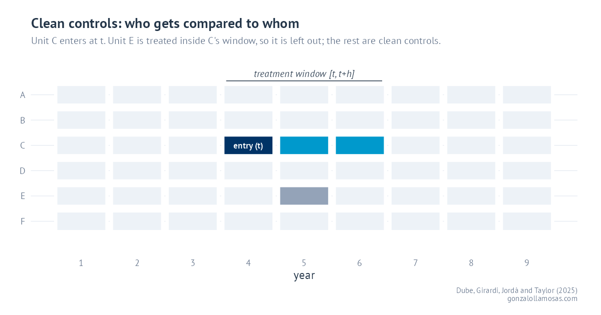

{.post-banner fig-alt="Schematic of the clean-control rule. The treated unit enters at year t with a window to t plus h; a unit that treats inside the window is excluded; the remaining rows are clean controls."}

Event studies on macro panels have a known problem. In a standard two-way
fixed effects setup, countries that treated earlier serve as controls for
countries that treat later, and vice versa. When treatment effects are
heterogeneous or dynamic, those comparisons contaminate the estimates, a
point the difference-in-differences literature has made forcefully over
the last few years. Fiscal policy applications are especially exposed,
because consolidation episodes cluster in time, think 2010 to 2013, and
their effects build slowly.

The Local Projections Difference-in-Differences estimator of Dube,
Girardi, Jordà and Taylor (2025, *Journal of Applied Econometrics*)
addresses this with two design choices that are easy to state and easy to
audit. In a paper with Cristina Mazas Pérez-Oleaga and José M.
Domínguez-Martínez, now under review, we apply it to 125 fiscal
consolidation entries in the EU-27. A few practical lessons follow.

## The two design choices

First, treatment is defined as entry. The treatment indicator switches on
in the year a country crosses the consolidation threshold, an improvement
of at least one percentage point of potential GDP in the cyclically
adjusted primary balance, and what is estimated is the effect of entering an
episode, horizon by horizon.

Second, and this is the core of the method, the control group at each
horizon contains only clean observations, meaning countries that are not
treated anywhere in the window from the entry year to the horizon of
interest. No forbidden comparisons enter the estimate. The outcome is a
long difference from the pre-treatment year, and the specification adds
country fixed effects, year-by-horizon fixed effects, two lags of the
outcome change and lagged macro controls.

The cost is transparency about sample loss. Of the 128 entries in our
panel, 125 enter the estimation sample at the impact horizon and 97 remain
at five years, and the control pool shrinks as the horizon lengthens. We report the counts at
every horizon, and we would encourage anyone using the method to do the
same, because the estimand quietly changes with the surviving sample.

## The estimator in a few lines of R

Stripped to its essentials, the whole procedure fits on one screen. For
each horizon, build the long difference, flag the units that stay
untreated through the window, keep entries and clean controls only, and
run the fixed-effects regression.

```r
library(dplyr)
library(fixest)

lpdid_h <- function(panel, h) {
  df <- panel |>
    group_by(country) |>
    mutate(
      d_y   = lead(debt_gdp, h) - lag(debt_gdp, 1),           # long difference
      clean = slider::slide_dbl(entry, max, .after = h) == 0  # untreated in [t, t+h]
    ) |>
    ungroup() |>
    filter(entry == 1 | clean)                                # no forbidden comparisons

  # specification (ii) adds pb_l1, the primary balance in t-1
  feols(d_y ~ entry + d_debt_l1 + d_debt_l2 + x_l1 | country + year,
        data = df, cluster = ~country)
}

irf <- lapply(0:5, function(h) lpdid_h(panel, h))

# 27 clusters: complement with a wild cluster bootstrap (Webb weights)
fwildclusterboot::boottest(irf[[1]], param = "entry",
                           B = 9999, type = "webb")
```

Each element of `irf` is one point of the impulse response, and the
header figure of this post was drawn with the same logic. The real code
adds the placebo horizons, the trimming and the robustness battery, but
nothing conceptually new.

## What we learned applying it

Inference with 27 clusters deserves more care than the default. We cluster
at the country level and complement the usual standard errors with a wild
cluster bootstrap using six-point Webb weights, which behaves better with
few clusters. With our baseline controls, the short-run increase in the
debt ratio survives both. The more useful lesson came from somewhere else.

Check covariate balance before reading any coefficient. Our entrants
started with a primary balance 2.6 points of GDP worse than their controls,
and countries with worse balances accumulate more debt whether or not they
consolidate. Adding the lagged primary balance to the controls removes the
short-run increase and leaves the response imprecisely estimated around
zero. We now report every estimate with and without it.

Pre-trends are worth showing and worth reading with care. Placebo
coefficients one to three years before entry are insignificant in both
specifications, but under the baseline all three are positive, and a
sensitivity analysis in the spirit of Rambachan and Roth (2023) shows that
the baseline impact estimate is fragile to modest violations of parallel
trends. An insignificant placebo is not the same as a flat pre-trend.

Power, not bias, is the binding constraint at long horizons. Our point
estimates grow with the horizon while their precision falls, and the
honest reading is that the short-run estimates are the informative ones.

The paper, which also decomposes the debt response exactly into the
primary balance, the snowball effect and stock-flow adjustments, is under
review; the [Research](../../research.qmd) page has a summary.


